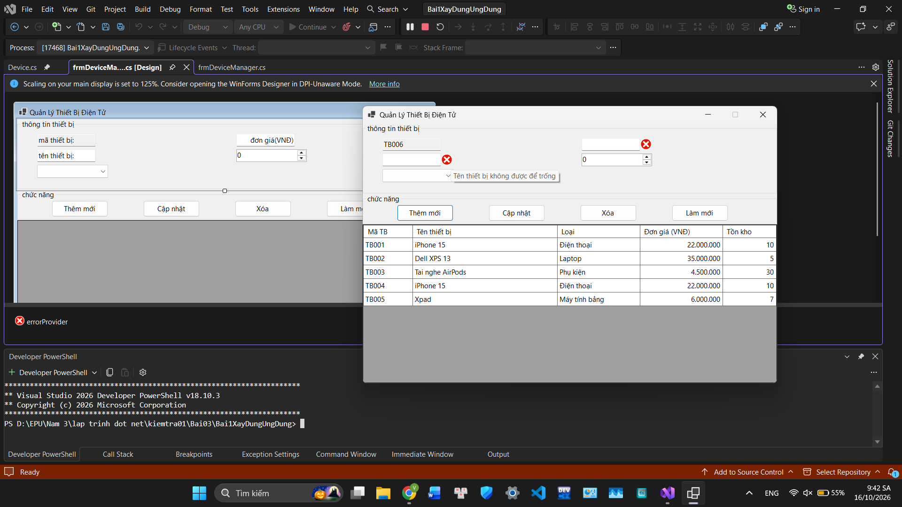

# Lập trình .NET

## Thông tin sinh viên
- **Họ và tên:** [Vũ Minh Thành]
- **Mã sinh viên:** [24810310190]
- **Lớp:** [D19CNPM3]

## Bài tập
BÀI 1: XÂY DỰNG ỨNG DỤNG QUẢN LÝ DANH MỤC THIẾT BỊ ĐIỆN
TỬ (CƠ BẢN & DATA BINDING)

## Kết quả

