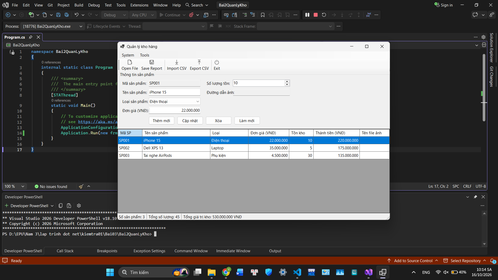
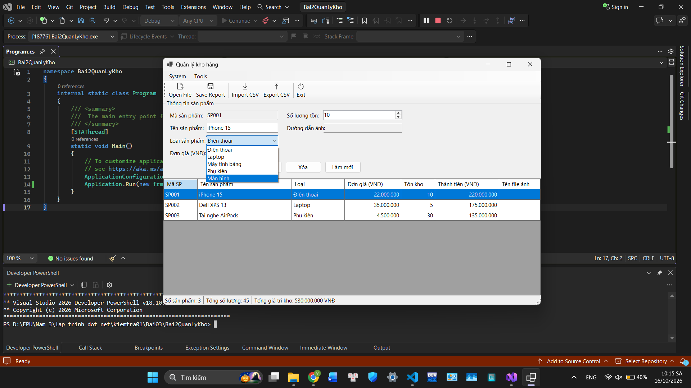
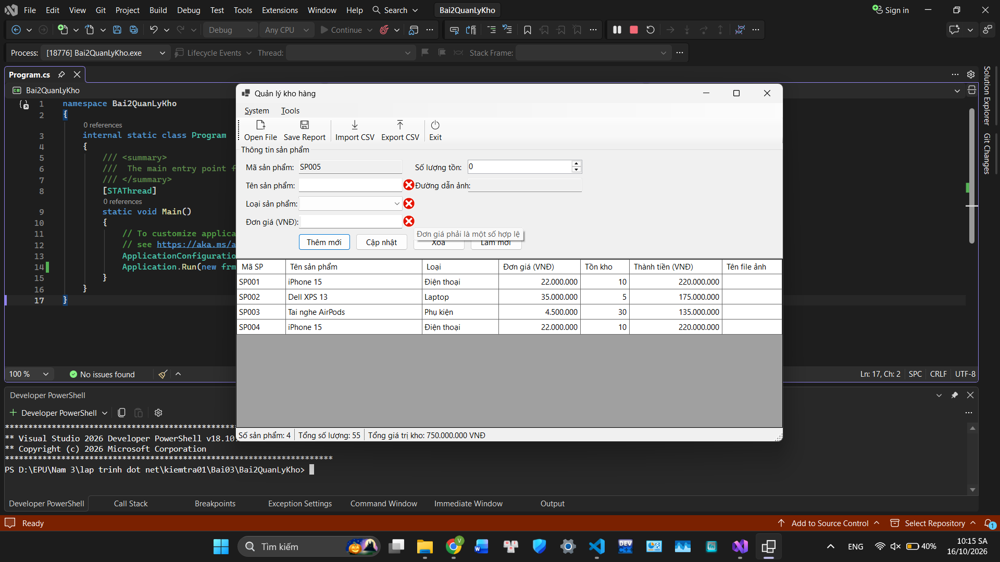
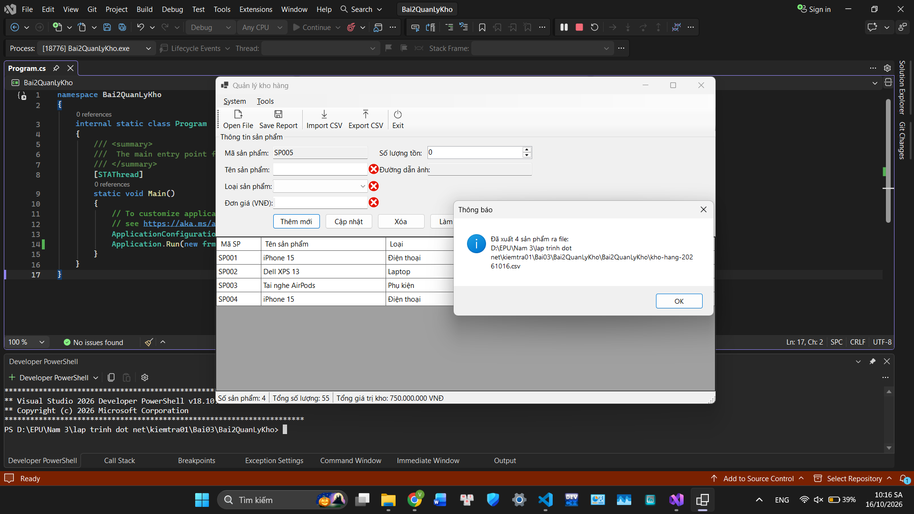
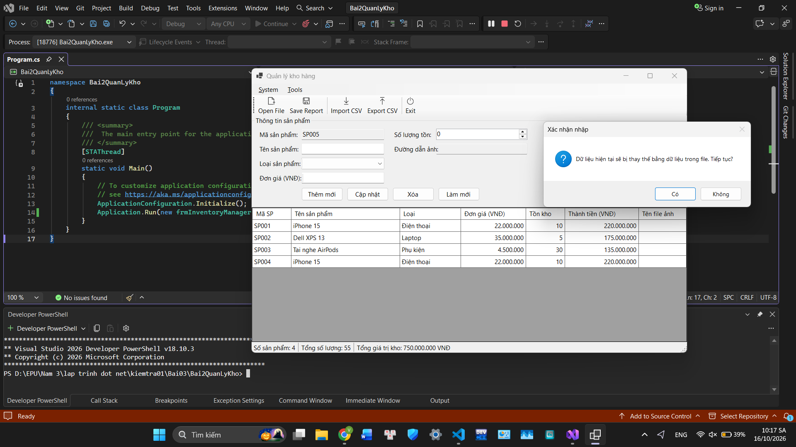
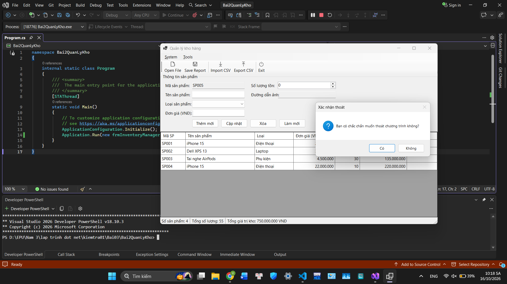

# Bài 2: Phần mềm quản lý kho và xuất báo cáo tổng hợp

## Thông tin sinh viên

| Thông tin | Nội dung |
|---|---|
| Họ và tên | **[Vũ Minh Thành]** |
| Mã sinh viên | **[24810310190]** |
| Lớp | **[D19CNPM3]** |
| Môn học | Lập trình .NET |

## Kết quả chạy chương trình

### Giao diện chính


### Chọn ảnh sản phẩm


### Kiểm tra dữ liệu (Validation)


### Xuất CSV


### Nhập CSV


### Xác nhận thoát


## Hướng dẫn chạy

1. Clone repository:
```bash
   git clone <đường-dẫn-repository>
```
2. Mở file `.sln` bằng Visual Studio (chỉ chạy được trên Windows).
3. Nhấn **F5** để chạy chương trình.

Hoặc dùng dòng lệnh:

```bash
dotnet run --project Bai2QuanLyKho
```