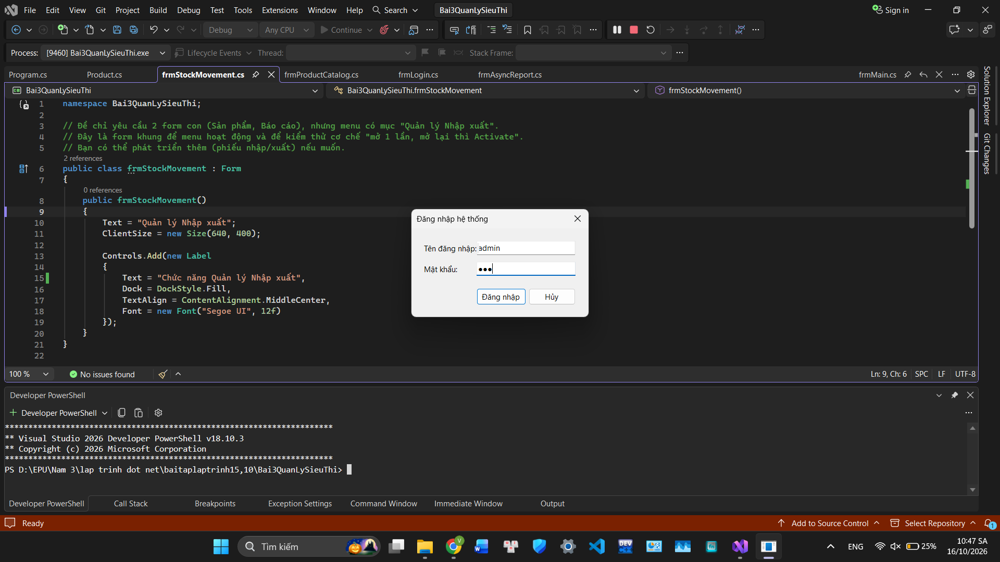
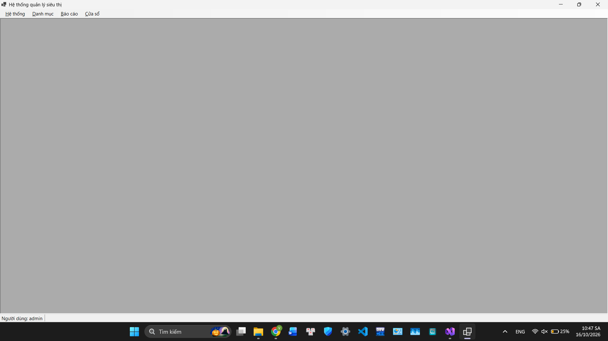
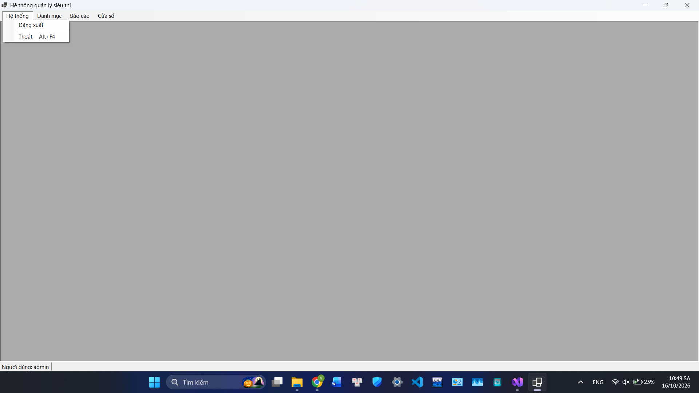
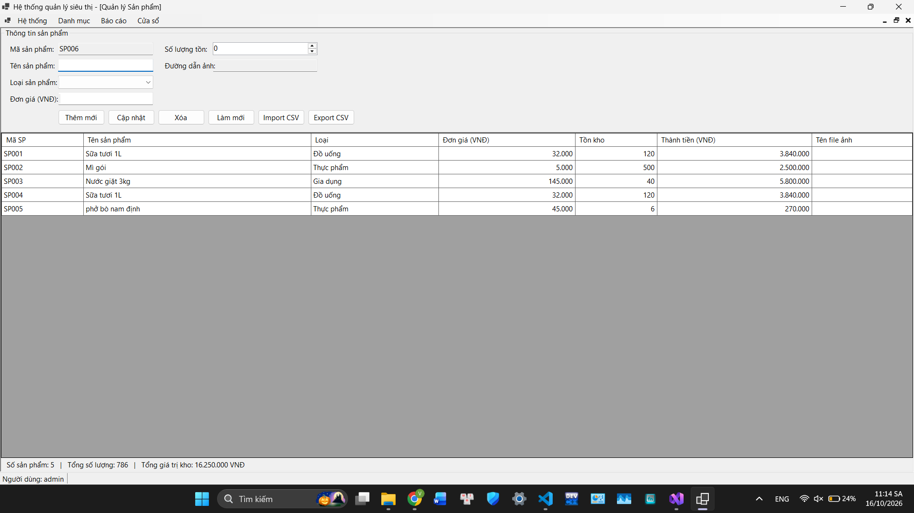
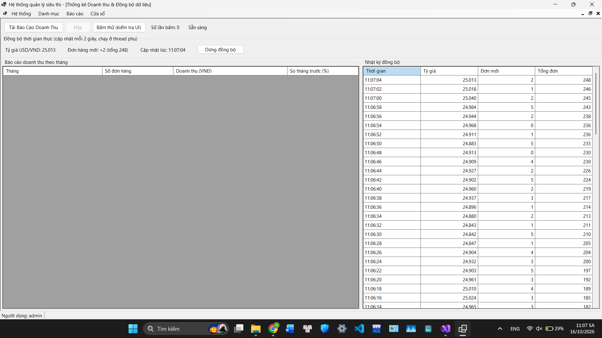
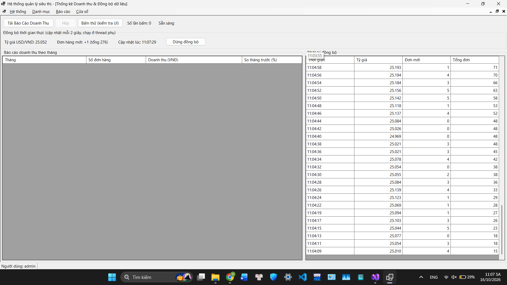

# Bài 3: Hệ thống MDI quản lý siêu thị & đồng bộ dữ liệu bất đồng bộ

## Thông tin sinh viên

| Thông tin | Nội dung |
|---|---|
| Họ và tên | **[Nhập họ tên đầy đủ]** |
| Mã sinh viên | **[Nhập mã sinh viên]** |
| Lớp | **[Nhập tên lớp]** |
| Trường | Đại học Điện lực (EPU) |
| Môn học | Lập trình .NET |
| Bài tập | Bài 3: Nâng cao - Async/Await & Multi-threading |

## Mô tả

Ứng dụng WinForms theo kiến trúc **MDI (Multiple Document Interface)** quản lý siêu thị. Ứng dụng xử lý các tác vụ tốn thời gian bằng `async/await` và `Task.Run` mà không làm đơ giao diện, đồng thời cập nhật giao diện an toàn từ thread phụ bằng `Invoke`. Toàn bộ giao diện được dựng bằng code (không dùng Designer).

## Mục tiêu kiến thức

- Xây dựng kiến trúc ứng dụng MDI chuyên nghiệp.
- Lập trình bất đồng bộ `async/await` để xử lý tác vụ nặng mà không gây "Not Responding".
- Áp dụng quy tắc Safe Cross-Thread (`Control.InvokeRequired`, `this.Invoke()`) khi cập nhật giao diện từ Background Task.

## Tài khoản đăng nhập demo

| Tên đăng nhập | Mật khẩu |
|---|---|
| `admin` | `123` |
| `nhanvien` | `123` |

## Kiến trúc hệ thống

### Form cha `frmMain` (MDI Container)

- `IsMdiContainer = true`.
- **MenuStrip**
  - Hệ thống: Đăng xuất, Thoát.
  - Danh mục: Quản lý Sản phẩm, Quản lý Nhập xuất.
  - Báo cáo: Thống kê Doanh thu.
  - Cửa sổ: Cascade, Tile Horizontal, Tile Vertical (kèm danh sách cửa sổ đang mở).
- **StatusStrip:** tên người dùng đang đăng nhập, thông tin đồng bộ mới nhất và `ProgressBar` dùng chung cho các thao tác tải dữ liệu nặng.

### Các Form con

| Form | Chức năng |
|---|---|
| `frmProductCatalog` | Quản lý sản phẩm (kế thừa Bài 1 & 2): thêm/sửa/xóa, validation bằng `ErrorProvider`, chọn ảnh, Import/Export CSV |
| `frmAsyncReport` | Tải báo cáo doanh thu bất đồng bộ và đồng bộ dữ liệu thời gian thực |
| `frmStockMovement` | Form khung cho mục Quản lý Nhập xuất |

## Chức năng chính

### Scenario A: Điều hướng MDI

Hàm generic `OpenChild<T>()` kiểm tra form con đã mở hay chưa:

- Đã mở: gọi `Activate()` đưa form lên trước (nếu đang thu nhỏ thì khôi phục).
- Chưa mở: tạo mới, gán `MdiParent = this` rồi `Show()`.

### Scenario B: Tải dữ liệu bất đồng bộ (async/await)

Nút **Tải Báo Cáo Doanh Thu** trong `frmAsyncReport`:

- Dùng `async`/`await` kết hợp `Task.Run` để đẩy tác vụ giả lập (3-5 giây) xuống thread phụ.
- Trong lúc chạy, UI Thread hoàn toàn phản hồi: vẫn di chuyển form, thao tác menu, mở form con khác được.
- `ProgressBar` trên StatusStrip của Form cha hiển thị tiến độ qua `Progress<int>`.
- Hỗ trợ **Hủy** tác vụ bằng `CancellationToken`.
- Có nút "Bấm thử" để kiểm chứng giao diện không bị đơ.

### Scenario C: Cập nhật UI an toàn từ Background Thread

- Một tiến trình nền (`Task.Run` + `Task.Delay`) giả lập đồng bộ tỷ giá và quét đơn hàng mới mỗi **2 giây**.
- Thread phụ **không truy cập trực tiếp control**. Dữ liệu được chuyển về UI Thread bằng `InvokeRequired` + `Invoke()` trước khi:
  - Gán text lên `Label`.
  - Thêm dòng mới vào `DataGridView` (nhật ký đồng bộ).
  - Cập nhật `StatusStrip` của Form cha.
- Có nút Bật/Dừng đồng bộ.

## Kết quả chạy chương trình

### Đăng nhập

### Form cha MDI

### Mở nhiều form con và sắp xếp cửa sổ (Tile / Cascade)

### Quản lý sản phẩm

### Tải báo cáo bất đồng bộ (ProgressBar đang chạy)

### Đồng bộ dữ liệu thời gian thực

